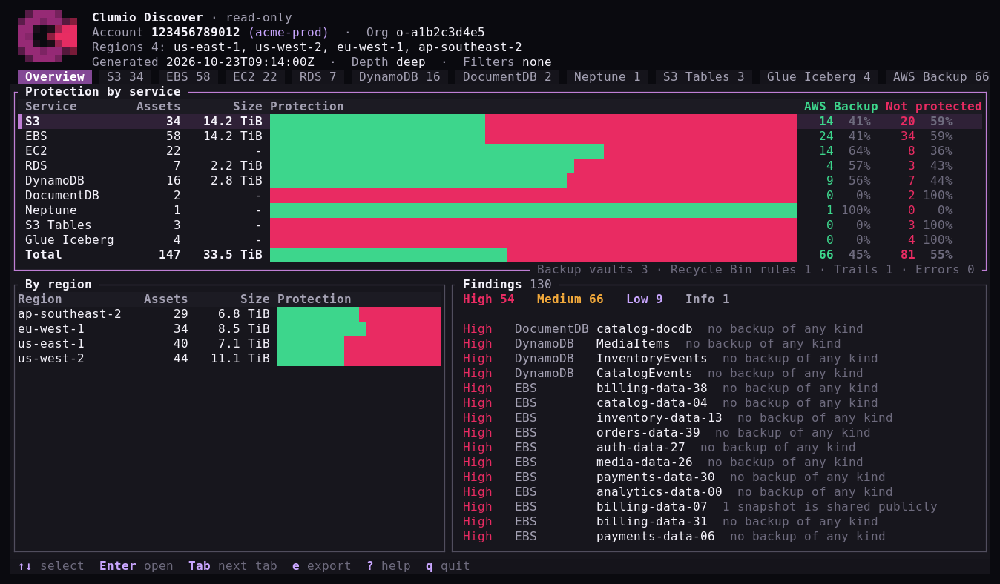
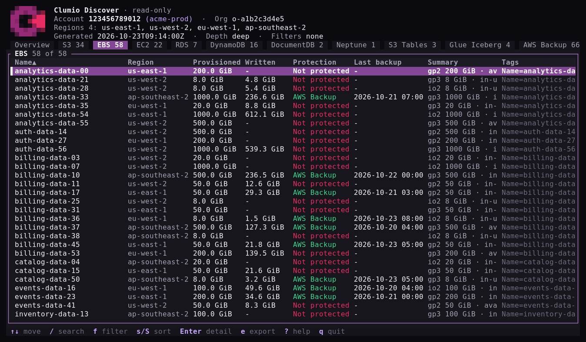

# Clumio Discover

See everything in your AWS account that Clumio can protect, and how well it's
protected today.



- **Read-only.** Only Describe, List and Get calls. Nothing in your account is
  created, changed or deleted.
- **Nothing to install in AWS.** No CloudFormation, roles or agents. It runs on
  your machine with your existing AWS login.
- **Stays with you.** Results are shown on screen or saved to a local file.
  Nothing is sent anywhere.

## What you need

1. The `clumio-discover` program for your platform. See [Install](#install).
2. An AWS login for the account to scan, the same one you use with the AWS CLI,
   or [AWS CloudShell](#aws-cloudshell), which needs no login setup at all.
3. Read access. The AWS managed policy **ReadOnlyAccess** (or admin) is enough.
   For least privilege, use the
   [`clumio-discover-readonly.json`](policy/clumio-discover-readonly.json)
   policy included in the download instead.

## Install

Pick the build for your computer:

| Computer | `PLATFORM` |
|---|---|
| Mac with Apple silicon (M1 or later) | `macos-arm64` |
| Mac with Intel | `macos-x86_64` |
| Linux x86_64, including AWS CloudShell | `linux-x86_64` |
| Linux arm64 (Graviton) | `linux-aarch64` |
| Windows | `windows-x86_64` |

The Linux builds run on any distribution, including Amazon Linux 2 and 2023.
What changed in each version is in [CHANGELOG.md](CHANGELOG.md).

### macOS and Linux

Download with the [GitHub CLI](https://cli.github.com), signed in with
`gh auth login`:

```
PLATFORM=macos-arm64
gh release download --repo cvlt-cloudnatives-resilience/clumio-discover-releases \
  --pattern "*-$PLATFORM.tar.gz" --pattern SHA256SUMS
```

or with curl:

```
PLATFORM=macos-arm64
VERSION=v0.3.3
BASE=https://github.com/cvlt-cloudnatives-resilience/clumio-discover-releases/releases/download/$VERSION
curl -fLO "$BASE/clumio-discover-$VERSION-$PLATFORM.tar.gz"
curl -fLO "$BASE/SHA256SUMS"
```

Check the download, unpack it and run it:

```
shasum -a 256 --ignore-missing -c SHA256SUMS     # on Linux: sha256sum --ignore-missing -c SHA256SUMS
tar -xzf clumio-discover-*-$PLATFORM.tar.gz
cd clumio-discover-*-$PLATFORM
./clumio-discover
```

To run it from any folder, move it onto your PATH:

```
sudo mkdir -p /usr/local/bin && sudo mv clumio-discover /usr/local/bin/
```

Downloads made with `gh` or curl open without a warning. If you downloaded with
a browser and macOS says the program can't be opened because it's from an
unidentified developer, clear the download flag once:

```
xattr -d com.apple.quarantine clumio-discover
```

### Windows

In PowerShell, download with the GitHub CLI:

```
gh release download --repo cvlt-cloudnatives-resilience/clumio-discover-releases --pattern "*-windows-x86_64.zip"
```

or with `Invoke-WebRequest`:

```
$Version = "v0.3.3"
$Name = "clumio-discover-$Version-windows-x86_64"
Invoke-WebRequest "https://github.com/cvlt-cloudnatives-resilience/clumio-discover-releases/releases/download/$Version/$Name.zip" -OutFile "$Name.zip"
```

Then unpack and run it:

```
Expand-Archive clumio-discover-*-windows-x86_64.zip -DestinationPath .
cd clumio-discover-*-windows-x86_64
.\clumio-discover.exe
```

If SmartScreen warns about an unrecognised app, choose **More info**, then
**Run anyway**, or run `Unblock-File clumio-discover.exe` first.

### AWS CloudShell

CloudShell runs in your browser from the AWS console and is already signed in
as you, so there is nothing to install on your computer and no credentials to
set up.

1. Sign in to the AWS console for the account to scan and open **CloudShell**
   from the toolbar.
2. Get the Linux build into CloudShell, either with curl:

   ```
   PLATFORM=linux-$(uname -m)
   VERSION=v0.3.3
   curl -fLO "https://github.com/cvlt-cloudnatives-resilience/clumio-discover-releases/releases/download/$VERSION/clumio-discover-$VERSION-$PLATFORM.tar.gz"
   ```

   or by downloading the `linux-x86_64` build on your computer and
   choosing **Actions → Upload file** in CloudShell.
3. Unpack and run it:

   ```
   tar -xzf clumio-discover-*-linux-*.tar.gz
   cd clumio-discover-*-linux-*/
   ./clumio-discover
   ```

4. To take the results with you, print the saved file's full path with
   `realpath inventory-*.json`, then choose **Actions → Download file** and
   paste it in.

Files in your CloudShell home folder are kept between sessions, so you can scan
again later without downloading it again.

## Run it

```
clumio-discover
```

Use `./clumio-discover` if you're in the unpacked folder and haven't moved it
onto your PATH. It scans every AWS region Clumio supports, saves the results to
`inventory-<account>-<date>.json` in the current folder, then opens the
inventory browser. To use a different AWS profile:

```
clumio-discover --profile my-profile
```

## Find your way around

| Key | Action |
|---|---|
| `Tab` / `←` `→` | Switch section: Overview, S3, EBS, EC2, RDS, DynamoDB, Findings… |
| `↑` `↓` | Move through a list |
| `Enter` / `Esc` | Open / close the details of a resource |
| `/` | Search |
| `f` | Filter, for example only resources that are not protected |
| `e` | Export the current list to CSV and JSON |
| `q` | Quit |

Each resource is either **AWS Backup** (protected by AWS Backup) or **Not
protected**, and **Last backup** shows its newest AWS Backup recovery point.
See [How protection is decided](#how-protection-is-decided) and
[How sizes are measured](#how-sizes-are-measured).



Under the table of services, the Overview also counts what protects the
account as a whole. Each has its own tab:

- **Backup vaults:** AWS Backup vaults and whether Vault Lock is on, at the
  bottom of the **AWS Backup** tab. That tab also lists every resource AWS
  Backup holds recovery points for.
- **Recycle Bin rules:** rules that keep deleted EBS snapshots and AMIs
  recoverable for a set number of days.
- **Trails:** CloudTrail trails, which record API calls, including every call
  this tool makes.
- **Errors:** AWS calls that failed. See
  [Missing permissions](#missing-permissions).

## Findings

**Findings** lists risks worth fixing, most serious first:

| Severity | Meaning | Examples |
|---|---|---|
| High | Data exposed to anyone, or nothing to restore from | No backup of any kind, public snapshot or AMI, S3 public access block off, database unencrypted or publicly accessible |
| Medium | A weakness that makes loss or exposure more likely | Backed up only outside AWS Backup, unencrypted EBS volume, S3 versioning off, RDS backups kept under 7 days, DynamoDB point-in-time recovery off |
| Low | A missing safety net against accidents | Deletion or termination protection off, backup vault without Vault Lock, region with no CloudTrail trail |
| Info | Worth knowing, not a risk on its own | Snapshots shared with other accounts, no Recycle Bin rule, instance that may run SQL Server |

## How protection is decided

A resource is **AWS Backup** when AWS Backup holds at least one recovery point
for it, in any region. Everything else is **Not protected**.

Backups made outside AWS Backup don't count: EBS snapshots, AMIs, RDS
automated backups and snapshots, and DynamoDB point-in-time recovery and
on-demand backups. They have no central schedule or retention and sit in the
same account as the resource. They're still listed in each resource's details
(press `Enter`).

S3 versioning, replication and object lock don't count either. A delete or
corruption is versioned or replicated along with everything else.

## How sizes are measured

Sizes come from metadata AWS already keeps. The tool never lists or reads
objects, files or data, so bucket and volume size make no difference to how
long a scan takes.

| Service | Size shown |
|---|---|
| S3 | CloudWatch daily storage metrics (`BucketSizeBytes`), added up across storage classes. Available for every bucket with no S3 Storage Lens setup. Includes noncurrent versions and incomplete multipart uploads, so a versioned bucket shows what you're billed for, not just its current objects. Updated once a day; a bucket created in the last day or two shows `-`. |
| EBS | **Provisioned** is the volume size you pay for. **Written** is the full size of the volume's latest snapshot: every block written to the volume, which tracks the space in use but can be higher after files are deleted. `-` usually means the volume has no snapshot. |
| RDS | Allocated storage. |
| Aurora, DocumentDB, Neptune | Cluster volume in use, from CloudWatch `VolumeBytesUsed`. |
| DynamoDB | Table size reported by DynamoDB, updated about every six hours. |
| EC2, S3 Tables, Glue Iceberg | Not shown. An instance's volumes are counted under EBS. |

The Overview adds up the same figures, so its EBS total is provisioned size.

## Deep scan

```
clumio-discover --deep
```

Also checks every EBS snapshot, RDS snapshot and AMI for public or
cross-account sharing. Recommended; on accounts with tens of thousands of
snapshots it takes a few minutes longer.

## Share the results

Every scan saves its results to `inventory-<account>-<date>.json`. Send that
file back to whoever asked you to run the scan, or open it again later on any
machine. Opening it needs no AWS access:

```
clumio-discover view inventory-123456789012-20261023T091400.json
```

The file contains resource names, IDs and tags from your account. Treat it as
confidential. To skip saving, add `--no-save`; to save without opening the
browser, use `--out <file>`.

## Options

Optional settings go in `~/.config/clumio-discover/config.toml`. Copy
[`config.example.toml`](config.example.toml) to get started; it covers
choosing regions, turning services off, and scanning only resources with a
given tag.

## Check that nothing changed

Every call the tool makes is recorded in AWS CloudTrail. In the CloudTrail
console, open **Event history**, filter by the user that ran the scan, and
confirm every event is read-only.

## Missing permissions

If your login can't read something, the scan still finishes. What it couldn't
read is listed in the **Errors** section, so you can add the permission and
scan again.

## Not an official Clumio product

This is an independent app for read-only discovery of the AWS resources Clumio
can protect, provided as-is. It is not an official Clumio or Commvault product
or statement. Clumio is a trademark of its owner. For questions about the
Clumio service, contact Clumio support. For this app, open an issue.

[Apache-2.0](LICENSE). Each download also includes `THIRD-PARTY-LICENSES.txt`,
the licenses of the open-source software built into the program.
